# AntiTheftDemo — Anti Theft Alarm

AntiTheftDemo là ứng dụng Android hỗ trợ cảnh báo khi điện thoại bị di chuyển, lấy ra khỏi túi hoặc mất các kết nối đang theo dõi. Dự án còn cung cấp chế độ báo pin đầy, giúp người dùng theo dõi thiết bị trong quá trình sạc.

Ứng dụng được xây dựng bằng Kotlin và Jetpack Compose. Màn hình **Home** là trung tâm điều khiển, hiển thị các chức năng dưới dạng lưới hai cột để người dùng chọn và kích hoạt chế độ phù hợp.

## Trải nghiệm từ lần đầu mở ứng dụng

### 1. Mở ứng dụng

Màn hình khởi động hiển thị tên ứng dụng và tiến trình tải trước khi chuyển sang phần thiết lập.

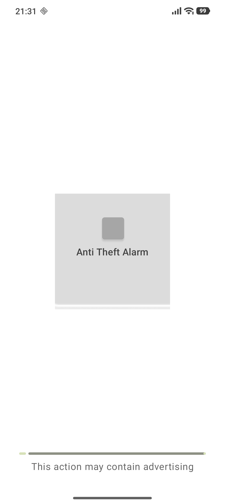

### 2. Chọn ngôn ngữ

Chọn ngôn ngữ hiển thị, sau đó nhấn dấu xác nhận để tiếp tục.

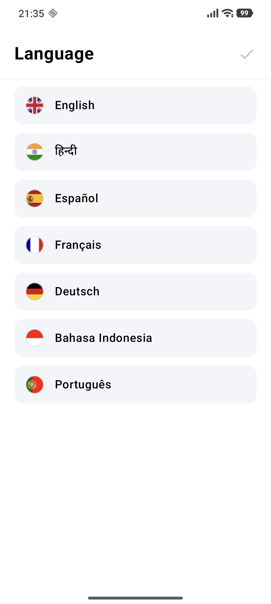

### 3. Xem giới thiệu

Nhấn **Next** để lần lượt xem ba trang giới thiệu chức năng.

| Giới thiệu chống lấy trộm | Giới thiệu báo pin đầy | Giới thiệu cảnh báo Wi-Fi |
| :---: | :---: | :---: |
| 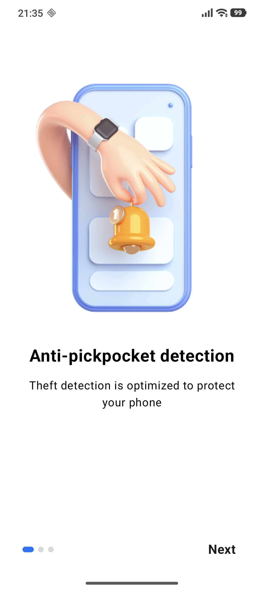 | 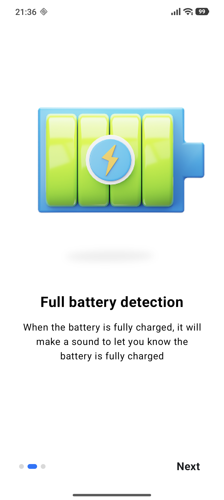 | 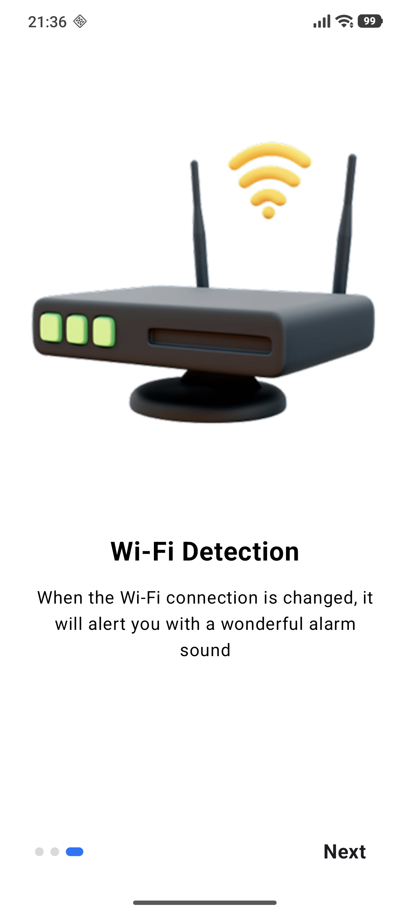 |

### 4. Cấp quyền thông báo

Tại màn hình **Permission**, bật **Allow access**, chọn **Cho phép** trong hộp thoại của Android, rồi nhấn **Continue** sau khi quyền đã được cấp.

| Mở yêu cầu cấp quyền | Chọn Cho phép | Quyền đã được cấp |
| :---: | :---: | :---: |
| 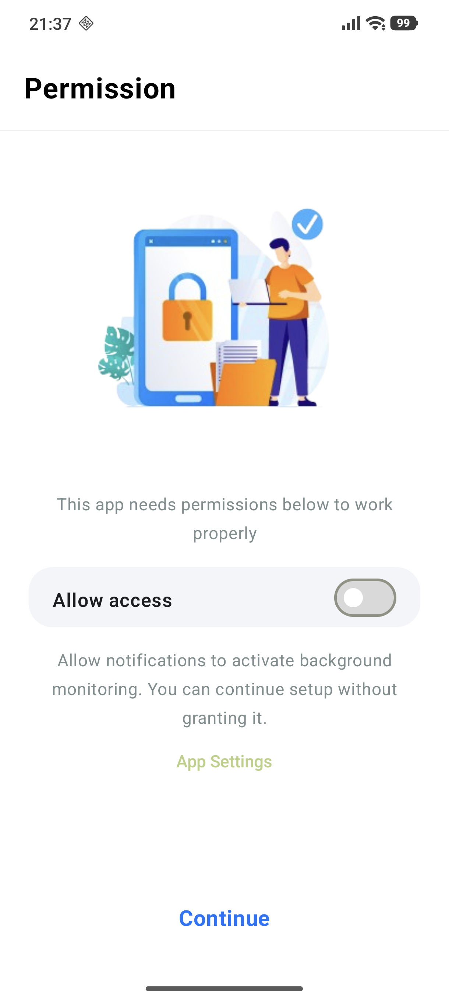 | 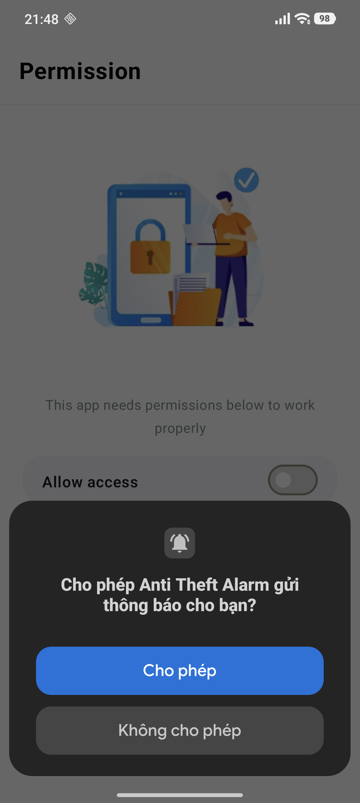 | 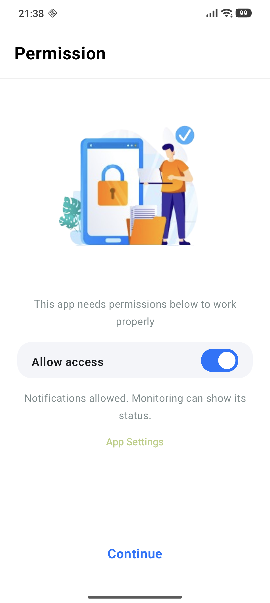 |

### 5. Tạo và xác nhận mật khẩu PIN

Nhập PIN gồm 4 chữ số, nhấn **Create**, nhập lại cùng mã PIN và nhấn **Submit** để hoàn tất thiết lập.

| Tạo PIN — Create | Xác nhận PIN — Submit |
| :---: | :---: |
| 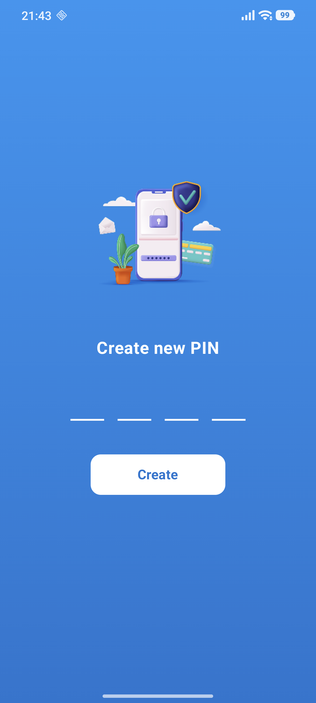 | 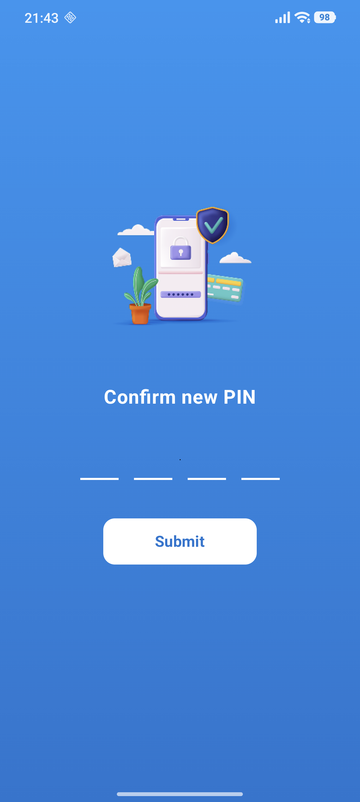 |

### 6. Vào màn hình Home

Sau khi thiết lập xong, Home hiển thị sáu chế độ. Chọn chức năng phù hợp để mở màn hình kích hoạt.

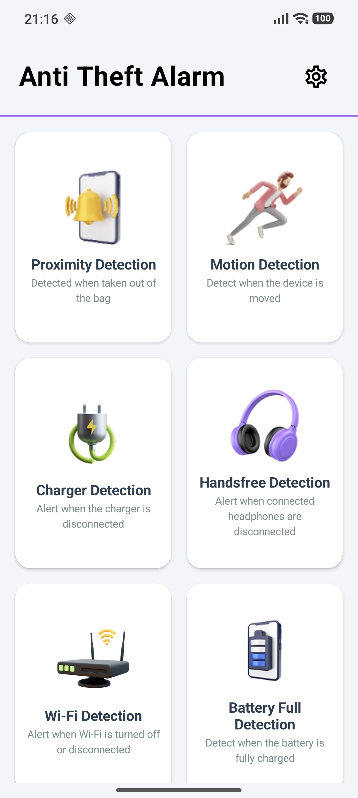

### 7. Chọn chế độ và kích hoạt

Mỗi chức năng có màn hình riêng. Chuẩn bị cảm biến hoặc kết nối theo yêu cầu, rồi chạm vòng tròn **Active** để bắt đầu giám sát.

| Phát hiện tiệm cận | Phát hiện chuyển động |
| :---: | :---: |
| 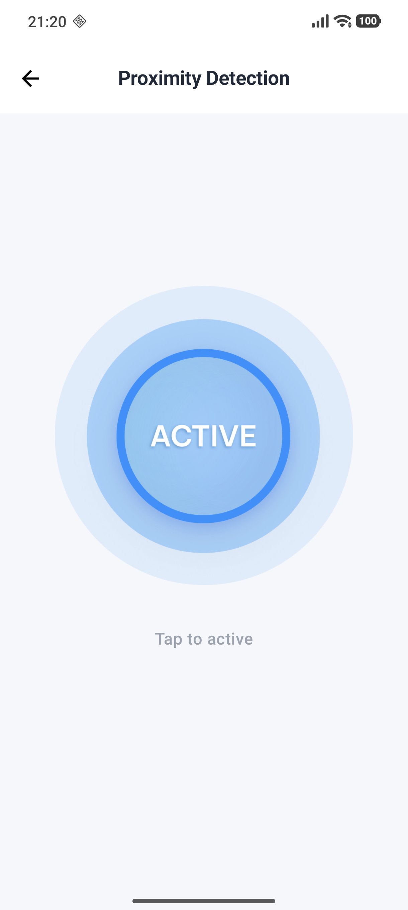 | 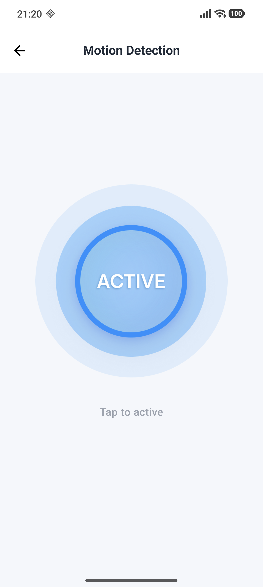 |

| Phát hiện ngắt sạc | Phát hiện ngắt tai nghe |
| :---: | :---: |
| 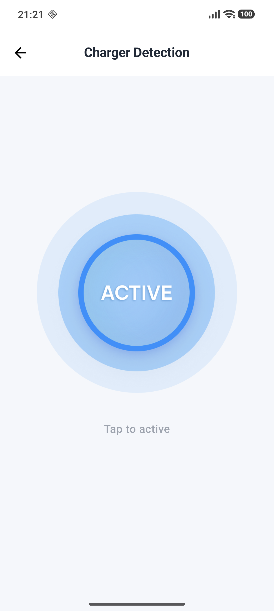 | 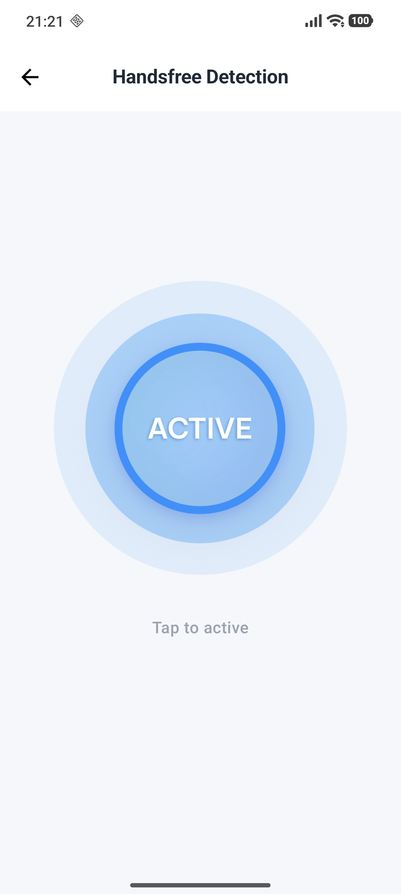 |

| Phát hiện mất Wi-Fi | Phát hiện pin đầy |
| :---: | :---: |
| 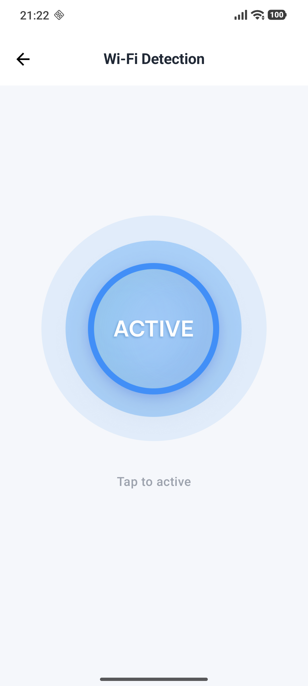 | 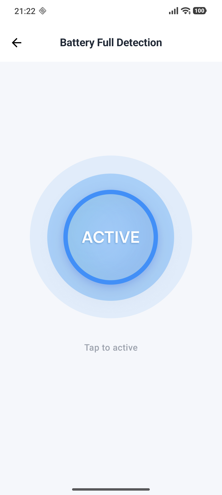 |

### 8. Theo dõi bảo vệ và xác thực để dừng

Ví dụ với chế độ Wi-Fi: khi giám sát bắt đầu thành công, màn hình hiển thị **Secured**. Để dừng, chọn **Deactivate**, nhập PIN và nhấn **Check**. Sau khi xác thực thành công, chạm vòng tròn **Stop** để xác nhận dừng bảo vệ và trở về Home.

| Đang bảo vệ — Secured | Xác thực PIN — Check | Xác nhận dừng — Stop |
| :---: | :---: | :---: |
| 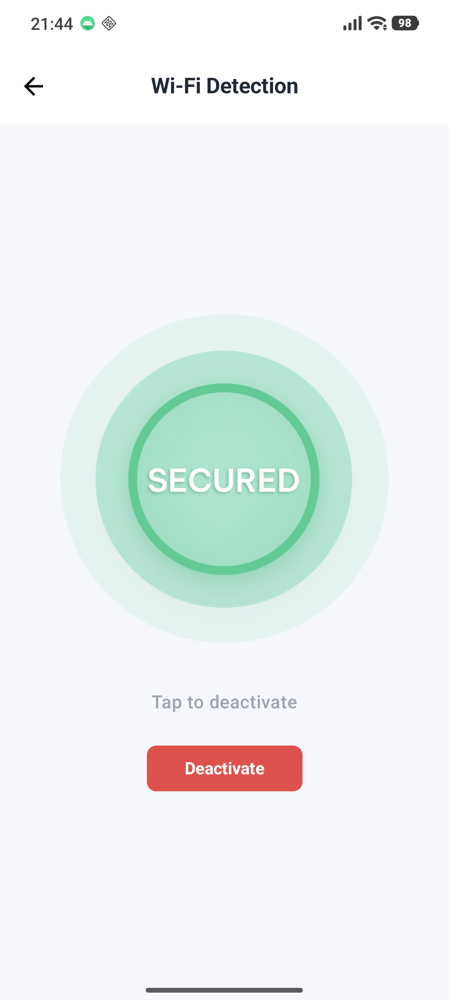 | 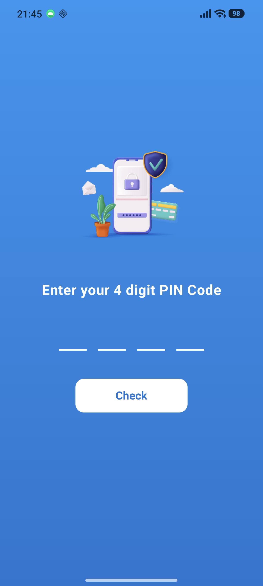 | 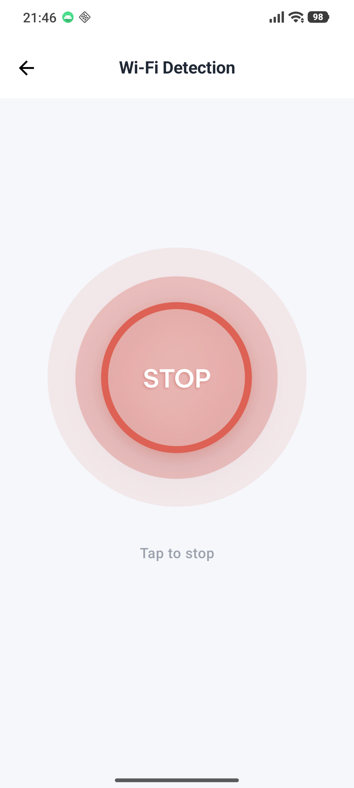 |

**Mỗi thời điểm chỉ có một chế độ giám sát hoạt động.** Cần tắt chế độ hiện tại bằng PIN trước khi bật chế độ khác.

### 9. Tùy chỉnh khi cần

Từ Home, nhấn biểu tượng bánh răng để mở **Settings** và tùy chỉnh PIN, âm báo, ngôn ngữ, flash hoặc rung.

Nếu cần xem lại quyền hay kênh thông báo, mở **App Settings** từ màn hình Permission để đến trang cài đặt thông báo của Android. Đây là thao tác tùy chọn, không bắt buộc trong luồng thiết lập lần đầu khi đã cấp quyền thành công.

| Cài đặt trong ứng dụng | Cài đặt thông báo của Android |
| :---: | :---: |
| 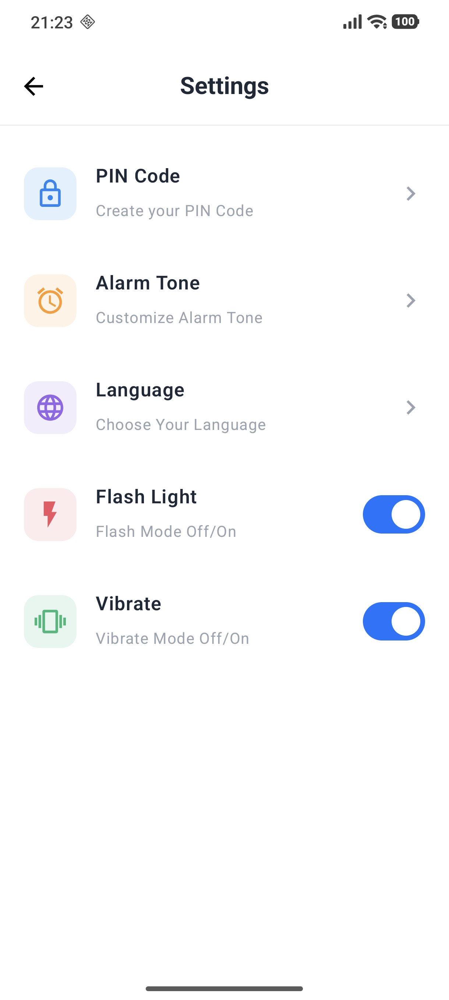 | 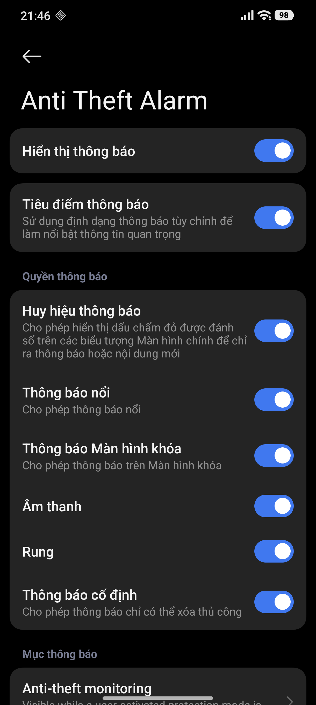 |

*Ảnh PIN được chụp bằng bản demo riêng phục vụ tài liệu; ứng dụng chính vẫn chặn chụp màn hình PIN bằng `FLAG_SECURE`.*

## Các chức năng trên Home

| Chức năng | Mô tả | Điều kiện sử dụng |
| --- | --- | --- |
| **Proximity Detection — Phát hiện tiệm cận** | Cảnh báo khi cảm biến chuyển từ trạng thái bị che sang không bị che, chẳng hạn khi lấy điện thoại ra khỏi túi. | Thiết bị có cảm biến tiệm cận; cảm biến cần nhận trạng thái bị che trước. |
| **Motion Detection — Phát hiện chuyển động** | Sử dụng cảm biến gia tốc để phát hiện điện thoại bị di chuyển. | Thiết bị có cảm biến gia tốc; có khoảng ổn định ban đầu trước khi phát hiện. |
| **Charger Detection — Phát hiện ngắt sạc** | Phát cảnh báo khi nguồn sạc bị ngắt. | Kết nối sạc trước khi kích hoạt. |
| **Handsfree Detection — Phát hiện ngắt tai nghe** | Cảnh báo khi không còn tai nghe được hỗ trợ kết nối với thiết bị. | Kết nối tai nghe có dây hoặc Bluetooth trước khi kích hoạt. |
| **Wi-Fi Detection — Phát hiện mất Wi-Fi** | Cảnh báo khi Wi-Fi bị tắt hoặc kết nối Wi-Fi đang theo dõi bị mất. | Bật Wi-Fi trước khi kích hoạt; phát hiện mất kết nối cần có kết nối trước đó. |
| **Battery Full Detection — Phát hiện pin đầy** | Phát cảnh báo khi pin chuyển từ dưới 100% lên 100% trong lúc cắm sạc. | Bật chế độ khi pin chưa đầy để theo dõi lần sạc đến 100%. |

Home đồng thời hiển thị trạng thái khởi động giám sát, chế độ đang bảo vệ và cảnh báo đã được kích hoạt. Thẻ của chế độ đang bảo vệ được tô nổi bật; người dùng có thể mở lại màn hình chức năng để xử lý.

## Luồng sử dụng

1. Trong lần mở đầu tiên, chọn ngôn ngữ, xem giới thiệu, xem xét quyền thông báo và tạo mã PIN gồm 4 chữ số.
2. Từ Home, chọn một trong sáu chức năng và chạm nút kích hoạt ở giữa màn hình.
3. Khi giám sát bắt đầu thành công, chế độ chuyển sang trạng thái **Secured**. Ứng dụng sử dụng dịch vụ giám sát nền và thông báo để hiển thị trạng thái.
4. Khi phát hiện sự kiện tương ứng, ứng dụng kích hoạt cảnh báo theo cấu hình.
5. Để tắt bảo vệ, chọn **Deactivate**, xác thực PIN rồi chạm **Stop** để xác nhận dừng.

**Mỗi thời điểm chỉ có một chế độ giám sát hoạt động.** Cần tắt chế độ hiện tại bằng PIN trước khi bật chế độ khác.

## Cài đặt

Từ biểu tượng bánh răng trên Home, người dùng có thể:

- Thiết lập hoặc thay đổi mã PIN.
- Chọn âm báo và nghe thử khi không có phiên bảo vệ hoạt động.
- Thay đổi ngôn ngữ hiển thị.
- Bật/tắt đèn flash và rung khi cảnh báo, tùy khả năng của thiết bị.

## Công nghệ và tổ chức mã nguồn

- **Giao diện:** Jetpack Compose, Material 3.
- **Điều hướng:** Navigation Compose.
- **Quản lý trạng thái:** ViewModel, StateFlow và thu thập trạng thái theo vòng đời.
- **Giám sát:** cảm biến Android, sự kiện nguồn điện/pin, thiết bị âm thanh và kết nối Wi-Fi.
- **Kiểm thử:** JUnit, AndroidX Test, Espresso và Compose UI Test.

Các thư mục chính nằm trong `app/src/main/java/com/example/antitheftdemo/`:

```text
home/          Màn hình chính và danh sách chế độ
 detection/    Giao diện, trạng thái, quy tắc và dịch vụ giám sát
alarm/         Phát âm báo, quản lý audio focus, flash và rung
settings/      Cấu hình cảnh báo
pincode/       Giao diện và ViewModel nhập PIN
security/      Lưu trữ, chính sách và xác thực PIN
navigation/    Điều hướng và luồng tắt bảo vệ
language/      Lựa chọn và áp dụng ngôn ngữ
intro/         Giới thiệu ứng dụng
permission/    Hướng dẫn quyền truy cập
```

## Cài đặt và chạy

1. Mở thư mục dự án trong Android Studio có hỗ trợ Android Gradle Plugin **9.1.1**.
2. Cài Android SDK **37**, cấu hình Gradle JDK tương thích với AGP và đồng bộ Gradle.
3. Chọn thiết bị chạy **Android 7.0 (API 24)** trở lên, sau đó chạy module `app`.

Cấu hình hiện tại: `minSdk = 24`, `compileSdk = 37`, `targetSdk = 37`, phiên bản ứng dụng `1.0`.

Có thể build và chạy kiểm thử từ terminal tại thư mục gốc trên Windows:

```powershell
.\gradlew.bat assembleDebug
.\gradlew.bat testDebugUnitTest
.\gradlew.bat connectedDebugAndroidTest
```

Lệnh kiểm thử thiết bị yêu cầu máy thật hoặc emulator đang kết nối. Nên dùng máy thật để kiểm tra cảm biến, sạc, tai nghe, rung và đèn flash.

## Lưu ý sử dụng

- Cần cho phép thông báo và bật kênh thông báo giám sát trước khi kích hoạt bảo vệ.
- Khả năng phát hiện và cảnh báo phụ thuộc cảm biến, phần cứng và chính sách âm thanh của Android; ứng dụng hiển thị lỗi khi chức năng không khả dụng.
- Nếu Android dừng dịch vụ hoặc phiên giám sát bị gián đoạn, cần mở ứng dụng và kích hoạt lại chế độ.
- Đây là ứng dụng hỗ trợ cảnh báo tại thiết bị; hiệu quả phát hiện phụ thuộc điều kiện sử dụng thực tế.
